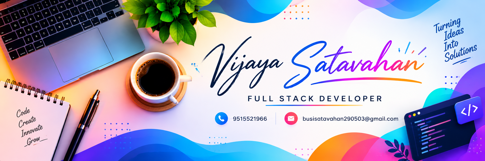

<!-- ===================== HEADER ===================== -->

<h1>Vijaya Satavahan Busi</h1>
<h3>Full Stack Software Developer</h3>

<b>C# · .NET · Angular · SQL Server · REST APIs</b>

Building scalable enterprise applications and reliable software solutions.

  

---

## About Me

I'm a **Full Stack Software Developer** focused on developing enterprise web applications using C#, .NET, Angular, and SQL databases.

- Backend development using C#, ASP.NET Core, and .NET Web API.
- Frontend development using Angular, HTML, CSS, and JavaScript.
- Database development and integration using SQL Server and MySQL.
- REST API development, testing, and integration.
- JWT authentication and authorization.
- API testing and documentation using Postman and Swagger.
- Writing clean, maintainable, and reliable application code.

---

## Technical Skills

### Programming Languages

### Frontend Development

### Backend Development

### Databases

### Developer Tools

---

## Core Concepts

- **Object-Oriented Programming:** Encapsulation, inheritance, abstraction, and polymorphism.
- **API Development:** HTTP methods, status codes, validation, and CRUD operations.
- **Authentication:** JWT-based authentication and authorization.
- **Database Management:** SQL queries, relational data, and database integration.
- **Performance:** Efficient queries, API response-time improvements, and caching fundamentals.

---

## Professional Experience

### Software Engineer — Containe Technologies Limited

**October 2025 – Present**

**Technologies:** C# · .NET · Angular · SQL Server

- Developed and maintained RESTful APIs for enterprise web applications.
- Contributed to backend API performance improvements.
- Developed frontend components for enterprise application modules.
- Implemented CRUD operations and database integrations.
- Tested and validated API endpoints using Postman and Swagger.
- Worked across frontend, backend, and database layers.
- Supported application maintenance, debugging, and code quality improvements.

---

## Featured Projects

<table>
<tr>
<td width="50%" valign="top">

### API Rate Limiter & ERP Applications

**Overview**

Enterprise application workflows and backend API functionality designed to support business operations.

**Key Features**

- REST API endpoints and CRUD operations.
- JWT authentication concepts.
- SQL database integration.
- Responsive frontend interfaces.
- API testing and application integration.

</td>
<td width="50%" valign="top">

### AI-Powered Real-Time Communication System

**Overview**

An AI-powered communication system designed to interpret sign-language gestures into text or speech.

**Key Features**

- Computer vision and deep learning.
- CNN-based gesture recognition.
- Python application development.
- Machine-learning classification.
- Accessibility-focused communication.

</td>
</tr>
</table>

---

## Education

### Bachelor of Technology — Computer Science and Engineering

**Sri Vasavi Institute of Engineering and Technology**

---

## Certifications & Professional Development

- **AWS AI/ML Data Engineer Internship**
- **Postman API Fundamentals Student Expert — 2025**

---

## GitHub Statistics

  

---

## Let's Connect

I'm interested in building reliable software, solving practical engineering problems, and continuously improving my development skills.

  

 
Thank you for visiting my profile.

